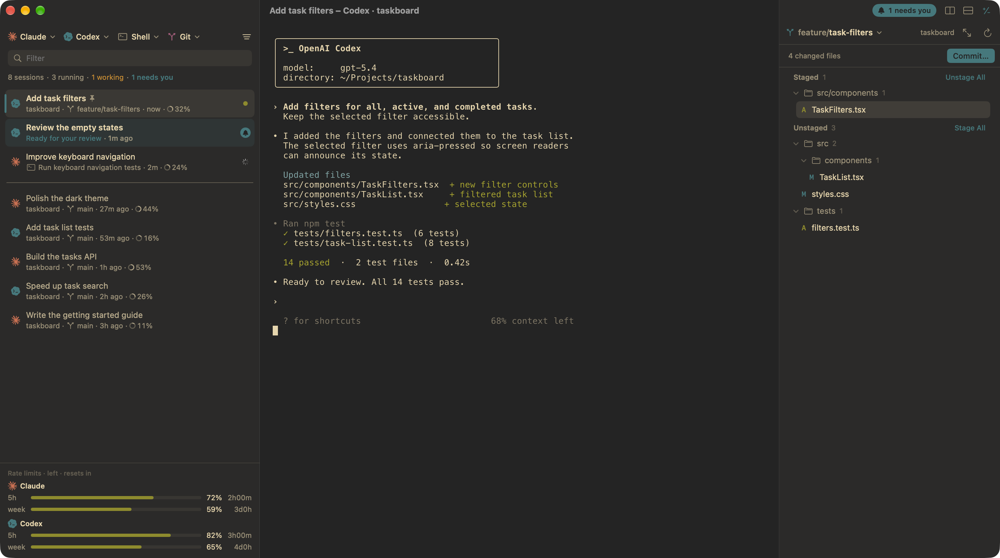
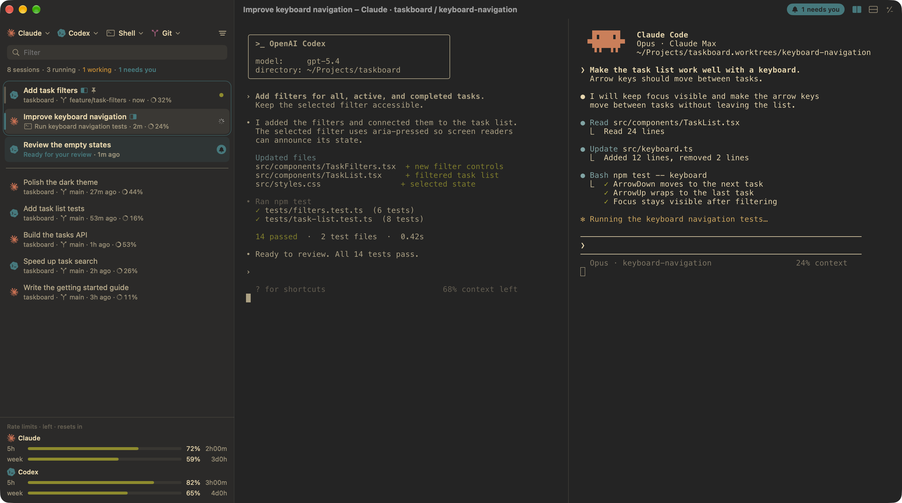
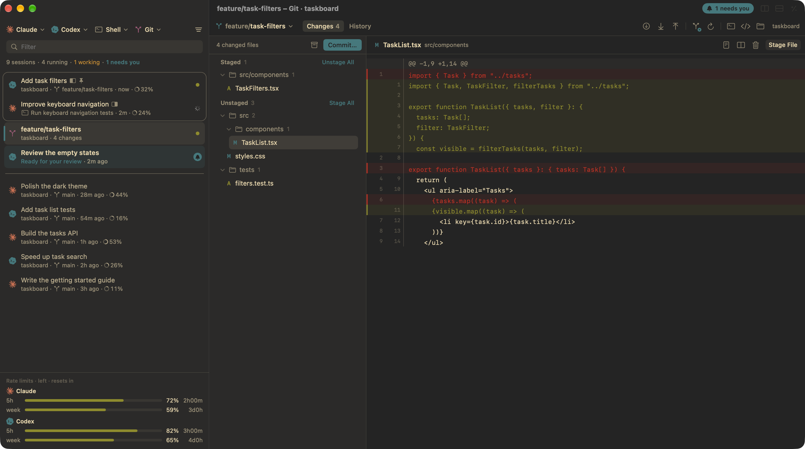
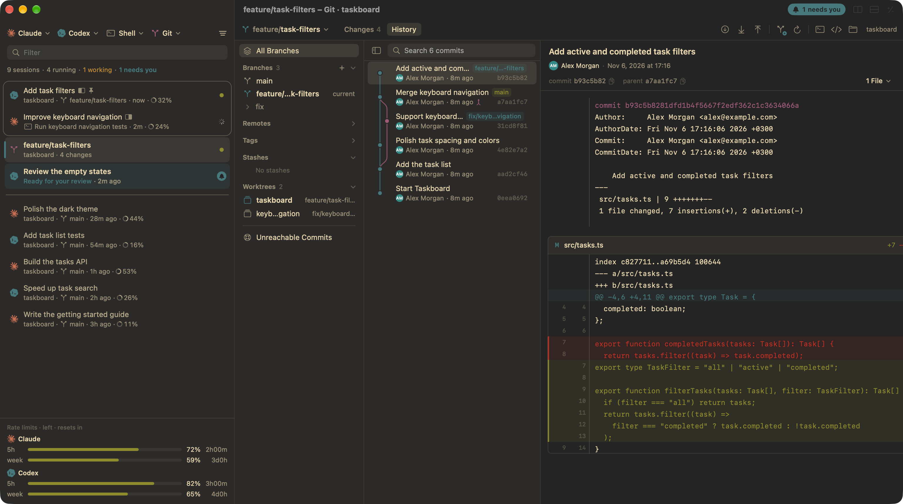

# agentz

A native macOS app that holds your Claude Code and Codex sessions in one place: a list of sessions, and the selected one running next to it in a [Ghostty](https://ghostty.org) terminal. Resume any session with one click, keep several agents running, and get a notification when one is done.

See [macos/README.md](macos/README.md) for how to use it. The Rust core it uses is in `core/`.

## Screenshots

**Sessions and status.** Keep Claude Code and Codex sessions together, see which agents are working or need you, and track context usage and rate limits. The Changes panel shows changed files beside the terminal.



**Split panes.** Work with two sessions side by side, including agents in separate git worktrees.



**Git changes.** Open a repository's Git tab to review diffs, stage files, hunks, or lines, and commit changes.



**Git history.** Browse the commit graph, branches, and worktrees, and inspect a commit's changes.



## Build

```sh
make            # build the app: macos/.build/Agentz.app
make install    # copy it to ~/Applications/Agentz.app
make test       # unit tests of everything
make check      # formatting and lints
make smoke      # open the app with real terminals and check it
```
